# A7 – FEA on Bracket

## Objective  
  
The objective of this Project is to take the bracket I have been designing in previous projects and improve its strength and stiffness while minimizing its mass using finite element analysis. Each design iteration of the bracket will be evaluated for maximum stress, displacement, and safety factor while using mesh refinement to check if the results converge within 7%. The results will guide geometrical changes to the bracket through at least three design iterations.  
  
I have been provided with these images during the entire bracket design process and I have been using them to guide my design process as well as my naming convention.  
  
  
  
  
  
Additionally, the material previously chosen for the bracket will remain the same throughout this process.  
  
  
  
## Design 1  
  
The first design I tested was the initial bracket I created in previous projects. The results of this will give me an idea of where the brackets weaknesses are and what needs to be changed.  
  
  
  
I began by treating the part of the bracket that rests on the T-beam (feature E) as a fixed point because it will maintain constant contact with the beam while the force is being applied.  
  
  
  
  
  
As I was applying the force to my bracket. I realized that by default, the force wants to distribute itself across the entire cylindrical surface, even the part that the hypothetical strap would not be touching. To fix this, I made some additional sketches onto the bracket to use as reference geometry to create a split line. This will allow me to apply the force to the only part of the bracket the hypothetical strap should being applying a force to.  
  
  
  
  
  
  
  
### Coarse mesh  
  
To begin testing on design 1, I created a coarse mesh and started the computational simulation. I made sure to record the details of each mesh I created in case I needed it later.  
  
  
  
  
  
  
  
  
  
  
  
### Medium mesh  
  
Next, I collected the data and ran the simulation again but with a mesh in between the coarse and fine extremes.  
  
  
  
  
  
  
  
  
  
#### Analysis and Interpretation  
  
The maximum stress is around double the yield strength in both the coarse and medium mesh simulations, which immediately tells me this bracket will fail where feature A connects to feature B.  
  
Despite this, I compared the data from the coarse and medium mesh simulations to check if they are converging within 7%. This will let me know if the results depend too much on mesh size and will inform me in the reliability of my geometry.  
  
  
  
Only the deflection was under 7% which means I cannot be completely confident in the data quite yet.  
  
### Fine mesh  
  
Because the data did not converge, I ran the simulation one more time but with a fine mesh.Because the data did not converge, I ran the simulation one more time but with a fine mesh.  
  
  
  
  
  
  
  
  
  
  
  
#### Analysis and Interpretation  
  
The maximum stress got even higher while the deflection did not change much. I would not be confident in using this bracket based on large differences between each kind of mesh.  
  
  
  
Except for the deflection, the differences between the medium mesh and fine mesh was even greater than that of the coarse and medium mesh.  
  
## Design 2  
  
The biggest weakness I gleaned from design 1 was right where feature A and B connect. In order to try and mitigate this weakness I decided to add a fillet at their intersection in an attempt to more evenly distribute the stress into feature B.  
  
  
  
  
  
However, I realized that it will still not be strong enough. A fillet will help reduce stress concentrations but with such a large maximum stress on the previous design, I decided I should do more than add only a fillet. In another attempt to distribute stress concentration and make the bracket more rigid, I also changed feature B to be much larger.  
  
  
  
  
  
  
  
These geometry changes increased the weight from 1.10 lbs to 1.14 lbs.  
  
### Coarse mesh  
  
  
  
  
  
  
  
  
  
  
  
### Medium mesh  
  
  
  
  
  
  
  
  
  
  
  
#### Analysis and Interpretation  
  
The changes to the geometry, compared to the first design, decreased both the maximum stress and deflection. However, the maximum stress still greatly exceeds the yield strength which tells me this bracket will most likely fail.  
  
However, the data for the coarse and mediums meshes converge within 7%. This tells me that the changes to the geometry were effective and I can have more confidence in the results of the simulation. Because of this, I did not run another simulation with a fine mesh and I moved onto the next design iteration.  
  
  
  
## Design 3  
  
The largest stress concentration for Design 2 was still at the point where features A and B connect at the fillet. To fix this, I increased the radius of the fillet from 0.1in to 0.2in to try and distribute the stress even further. Additionally, I noticed there was little to no stress around features C and E. Because of this, I decided to place large fillets of radius 0.4in at a few points on the bracket in order to cut down on material mass and offset the added weight from the increased size of feature B.  
  
  
  
  
  
I believe I could take off more material to further decrease the weight but I have to know when to stop optimizing and for the purpose of this project, I believe this is enough.  
  
  
  
The removal of material was effective because the weight dropped from 1.14 lbs to 1.07 lbs, which is a little bit lighter than design 1 as well.  
  
### Coarse mesh  
  
  
  
  
  
  
  
  
  
  
  
### Medium mesh  
  
  
  
  
  
  
  
  
  
  
  
#### Analysis and Interpretation  
  
  
  
The maximum stress is now below the yield strength, and the deflection has gotten even smaller. Additionally, this is the first time the safety factor has been greater than 1. The design changes made a large difference, but the convergence is still just outside of 7%. In order to be fully comfortable with this design, I decided to run the simulation with a fine mesh to see if the convergence would go below 7%.  
  
### Fine mesh  
  
  
  
  
  
  
  
  
  
  
  
#### Analysis and Interpretation  
  
  
  
The convergence did drop below 7% which means the geometry changes were successful and my design meets the project’s tolerance. With even more design iterations, the bracket could become lighter and stronger but I have reached a point where I am comfortable with this bracket design.  
  
## Reflection  
  
I learned that material placement and smooth transitions between features can play a much larger role than it seems. For example, from design 2 to design 3, the only strength related changes I made was increasing the fillet by 0.1 inches. However, this small change was enough to bring the max stress down by roughly a factor of 5.  
  
I also learned that checking mesh convergence helps ensure that my design decisions are based on stable simulation results. This will give me a lot more confidence going forward whenever I am creating more simulations.  
  
  
  
# 2157 Students Only - Finite Element Method  
  
## Design 1  
  
I followed the same exact process for designing this link as I did for the bracket.  
  
I decided to treat the hole that attaches to the bracket as a fixed point since it will be in tension from the applied force. Then I applied the 600 lbf to the opposite hole. I only used half of the cylindrical surface in each hole, similar to what I did with the bracket. I believe this will provide me with the most realistic distribution of forces.  
  
  
  
  
  
  
  
  
  
  
  
### Coarse mesh  
  
  
  
  
  
  
  
  
  
### Medium mesh  
  
  
  
  
  
  
  
  
  
#### Analysis and Interpretation  
  
  
  
The initial simulation did not give much feedback. The max stress is already less than half of the yield strength. The safety factor is greater than 1, the deflection is very minimal, and they converge well under 7%. There is not much room to improve on this design but I am going to attempt it.  
  
## Design 2  
  
The largest deflection was at the load bearing hole. I decided to put more material around it and add a 4in fillet in order to try and minimize deflection.  
  
  
  
  
  
  
  
  
  
This change added 0.05 pounds to the link.  
  
### Coarse mesh  
  
  
  
  
  
  
  
  
  
### Medium mesh  
  
  
  
  
  
  
  
  
  
#### Analysis and Interpretation  
  
  
  
The simulation results for the coarse mesh make it seem like the changes in geometry were effective. However, there was a very large convergence for the max stress and safety factor but I did manage to minimize the deflection more. The large changes between the coarse and medium meshes are signs that the data is not stable and should not be trusted yet. I decided to run the simulation again with fine mesh.  
  
### Fine mesh  
  
  
  
  
  
  
  
  
  
#### Analysis and Interpretation  
  
  
  
Despite the convergence percentage getting smaller, the data is still too unstable to trust.  
  
## Design 3  
  
The highest stress concentration is in the hole attached to the bracket. I believe the best way to modify this would be to remove unnecessary material to cut down on weight. So, I cut out part of the link closer to the bracket side since the stress concentration and deflection are low in that area. Then I applied a 2in fillet to each of the new edges.  
  
  
  
  
  
  
  
The mass decreased by 0.04 lbs making it only 0.01 lbs heavier than design 1.  
  
### Coarse mesh  
  
  
  
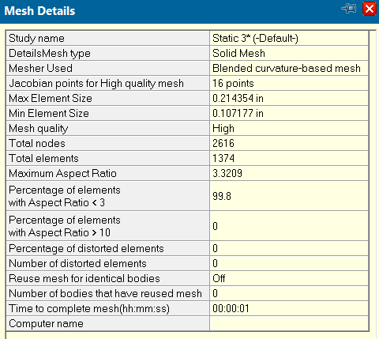  
  
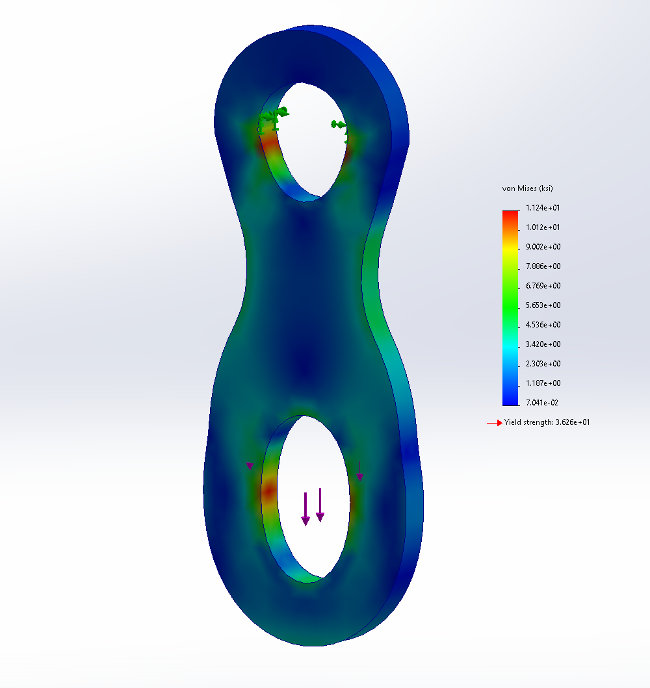  
  
### Medium mesh  
  
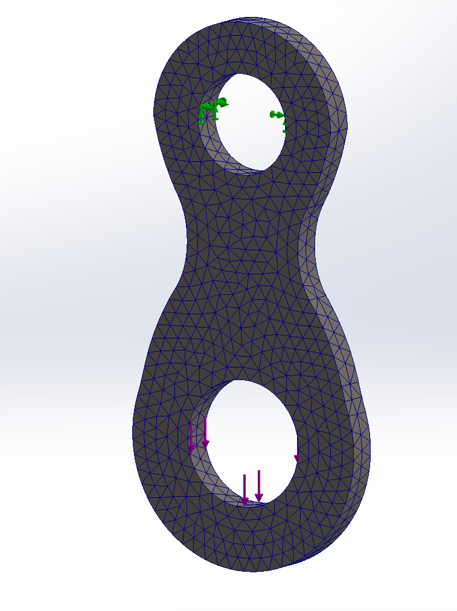  
  
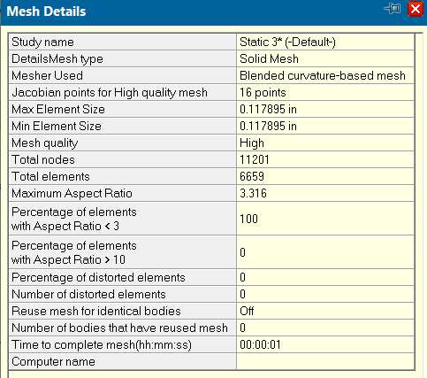  
  
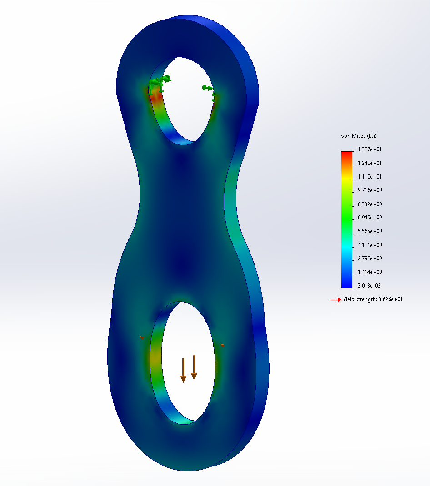  
  
#### Analysis and Interpretation  
  
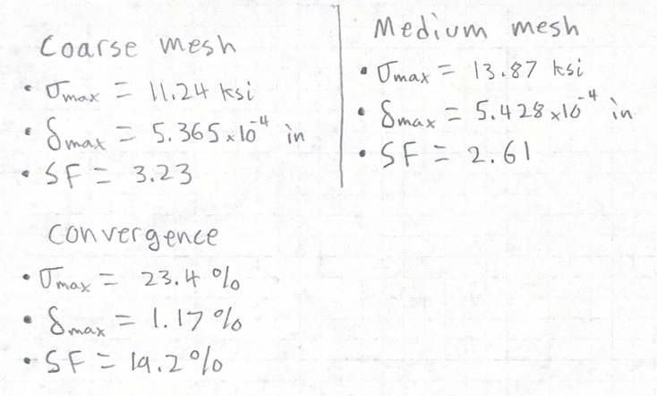  
  
The convergence percentage is still not as good as it was in the first design, but there are improvements from the second design. Since it is not under 7% I decided to run the simulation again with a fine mesh.  
  
### Fine mesh  
  
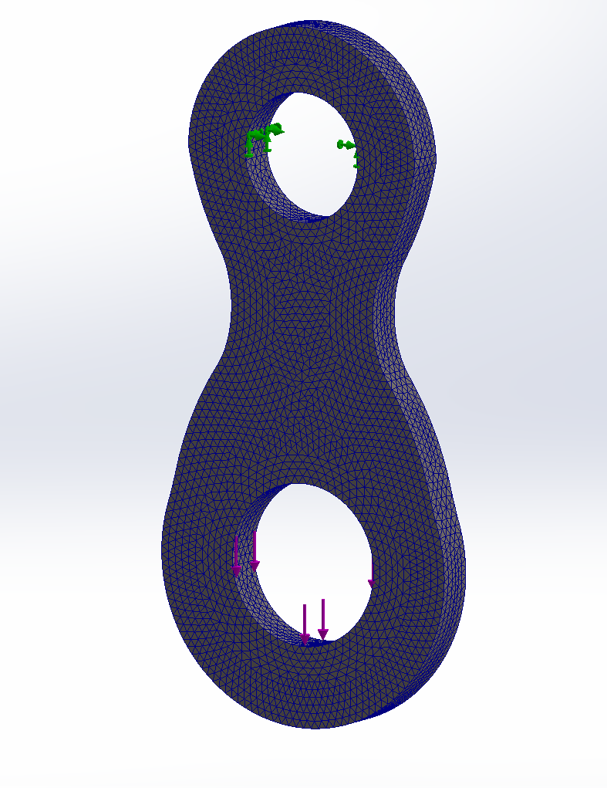  
  
  
  
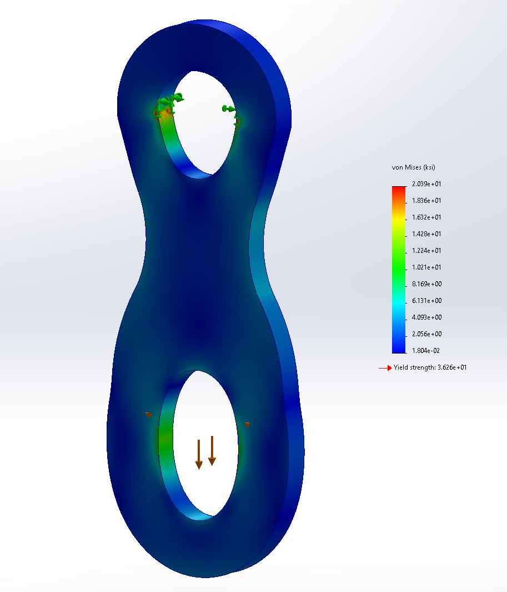  
  
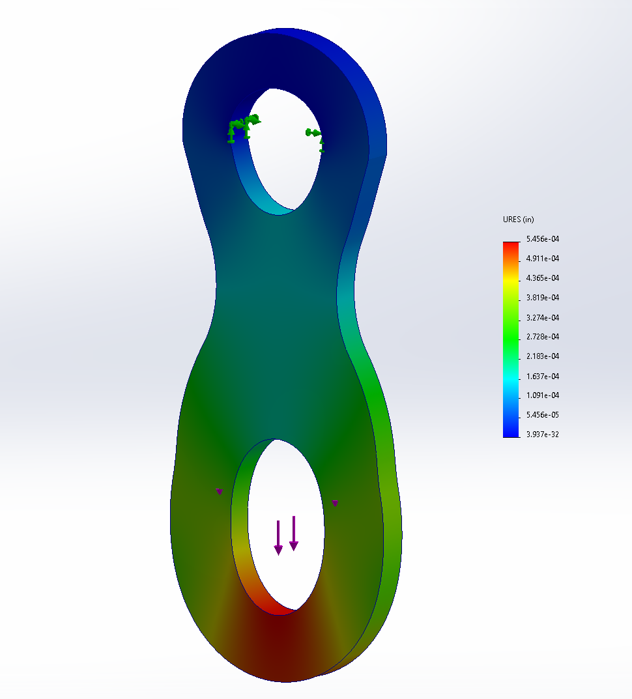  
  
#### Analysis and Interpretation  
  
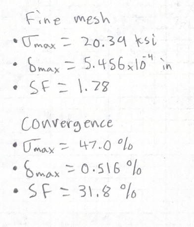  
  
The fine mesh simulation made the results more unstable. I am not entirely sure where I went wrong in this design or why the results are so inconsistent. However, the first design meets the projects tolerances and gives stable results with convergence percentages under 7%. Because of this, I am going to scrap the new design and stay with my original because it seems to be the most effective.  
  
## Reflection  
  
My bracket design got better with each design change while my linkage got worse. This taught me that the design process is not easy and it takes time. Just because one part of the design process goes smoothly does not mean the rest will.  
  
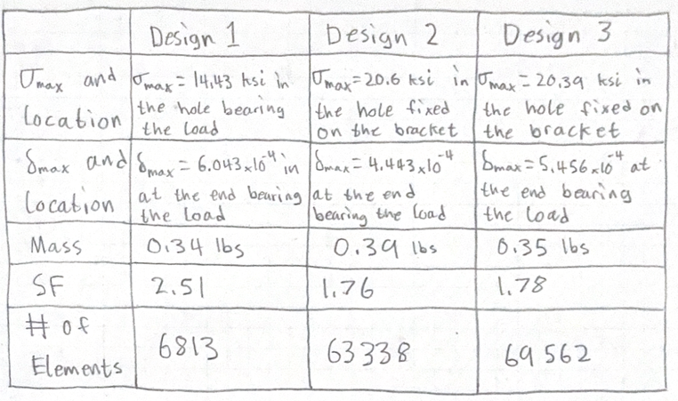  
  
## CAD FILES  
  
## HOW LONG THIS TAKE?  
  

## Analyze

## Decide

## Communicate
