# A9 – Pulley System Design

## Objective

The objective of this project is to design a pulley system to transfer power between two parallel axes separated by a center distance of 4–6 inches. Additionally, the following information and guidelines were provided: 

- Pulley Diameter: Both pulleys shall have a diameter of 3 inches.
- Rotational Speed: Select an operating speed between 1000–2000 rpm.
- Belt Tension (Static): Select a belt tension between 4–6 lbf under stationary conditions.
- Material: Pulleys may be made from aluminum, ABS, or steel, and may include a groove and shaft diameter of your choosing (within reasonable manufacturing limits).
- Safety Factor: The design must satisfy a minimum safety factor of 3.
- Assume the belt is made from polyurethane rubber, with a yield strength of 3.25 MPa (471 psi) at 20% strain

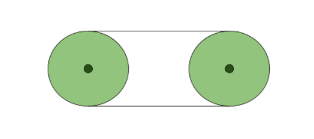

## Belt design

I began with the belt design by listing all my knowns and unknowns then sketching a free body diagram. The coefficient of friction was not given to us, so I had to find it on my own. I googled “polyurethane round belt coefficient of friction on steel” and got a couple different responses but I settled with a value of 0.7.

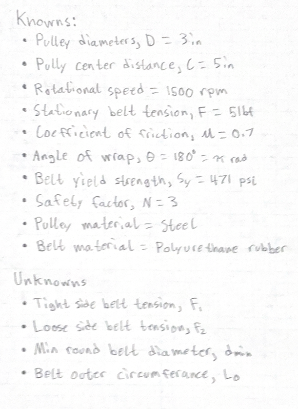

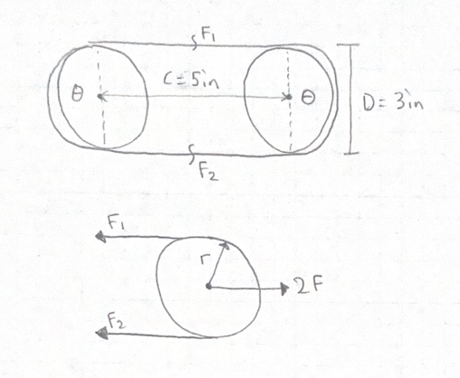

Then I solved for the forces, circumference, and used the stress to find the belts minimum diameter.

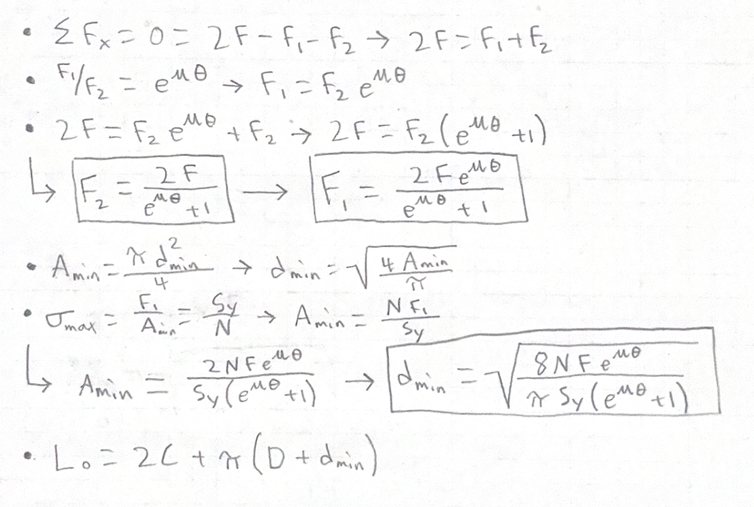

I planned for there to be a groove in the pulley with a depth equal to the radius of the belt. This made solving for the circumference simple.

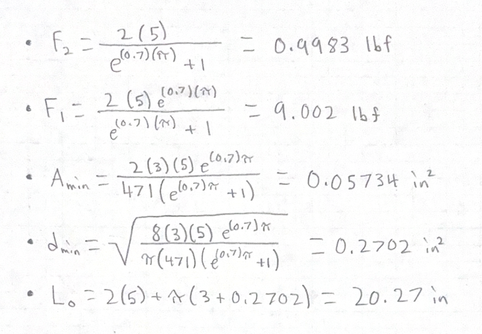

After solving for the variables, I looked at McMaster-Carr to find an appropriate belt for the pulley system. I had hoped to use a 5/16-inch diameter belt because it closely matched my calculated minimum diameter. However, the 5/16-inch belt only had circumference options over 24 inches. Because of this, I decided to pick the next biggest belt offered, which was a 3/8-inch diameter belt. 

The 3/8-inch belt had a larger diameter by a fair margin than my calculated minimum diameter. I used the 0.375-inch diameter of the belt to calculate the new circumference.

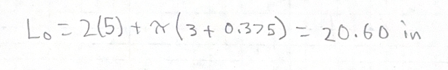

Then I picked the 3/8-inch belt size with a circumference of 20.5 inches because it should be a little bit smaller so there is static belt tension.

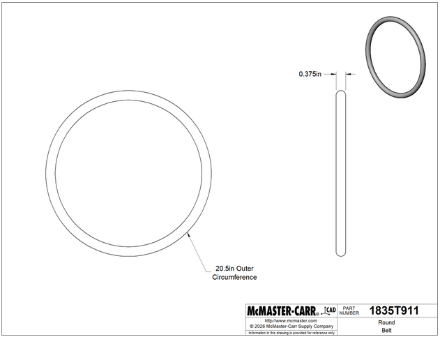

## Shaft design

I begin the shaft design by listing out all my knowns, unknowns, and drawing a free body diagram. The material required for the shaft was 1060 hardened steel. I had difficulty finding the shear yield strength for this material. I found various answers online, but I ended up settling with the strength of 94300 psi provided from the FabDigit website:

https://www.fabdigit.com/materials/steel-1060/q-t/#properties

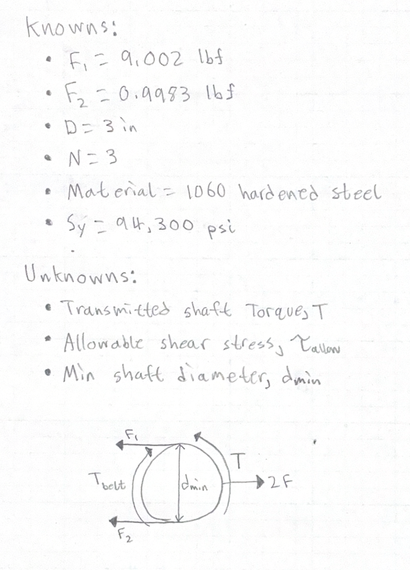

Then I used the given variables to solve for the minimum required diameter of the shaft.

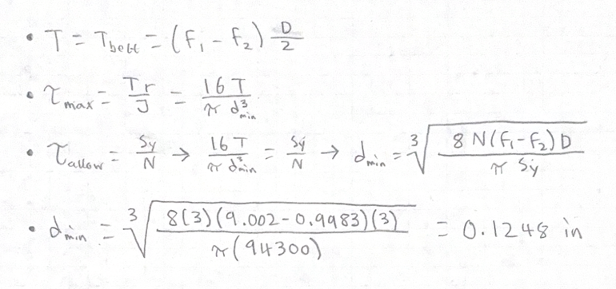

## Journal bearing design

I started the journal bearing design by listing all my knowns, unknowns, and sketching a FBD.

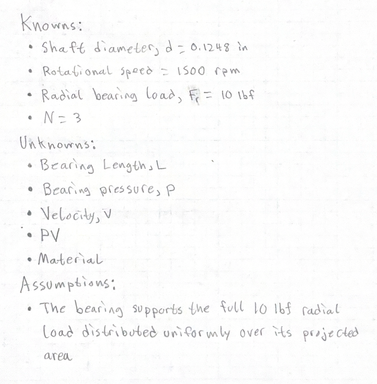

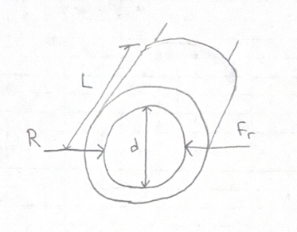

Next, I decided to pick a bearing length of 1 inch and then solved for my unknowns.

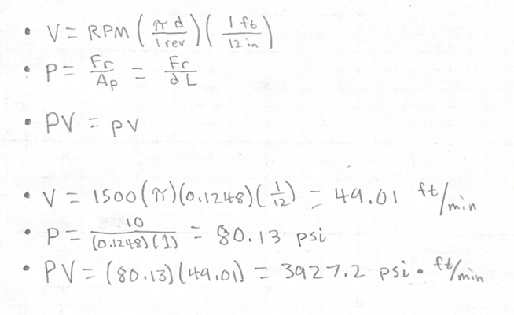

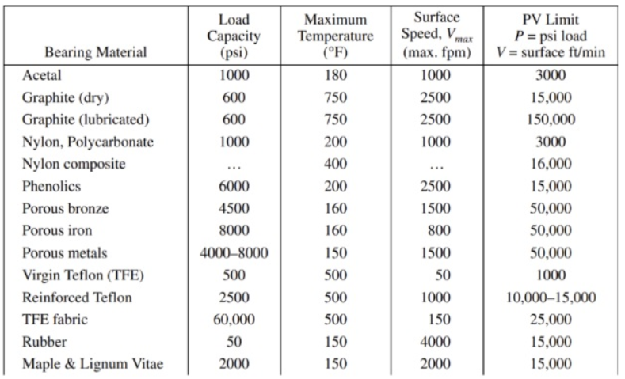

With the solved values, I used the table to decide that porous bronze will be the bearing material.

## Frame Design

I sketched a simple frame design for the pulley system. It is hard to create a frame when the purpose of the system is unknown.

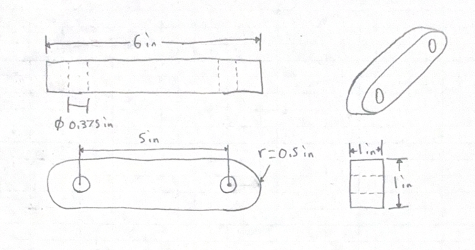

Additionally, I did simple stress and safety factor calculations.

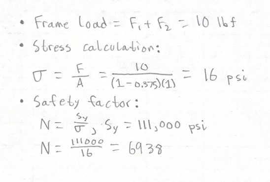

The safety factor came out to be a bit more than 3. Without knowing exactly what this frame is going to be doing it is hard to properly optimize the design. However, I think a safety factor of 6938 should be sufficient for this pulley system frame.

## Lessons learned

I learned that the difference between the tight-side and slack-side tensions produces a transmitted torque, while their sum creates the radial load on the shafts and bearings. Additionally, I learned how difficult it is to design something without having all the specifications. Without the desired specifications or purpose of the part it becomes a guessing game when designing a part.

## Time spent

I spent approximately 7 hours on this assignment.
